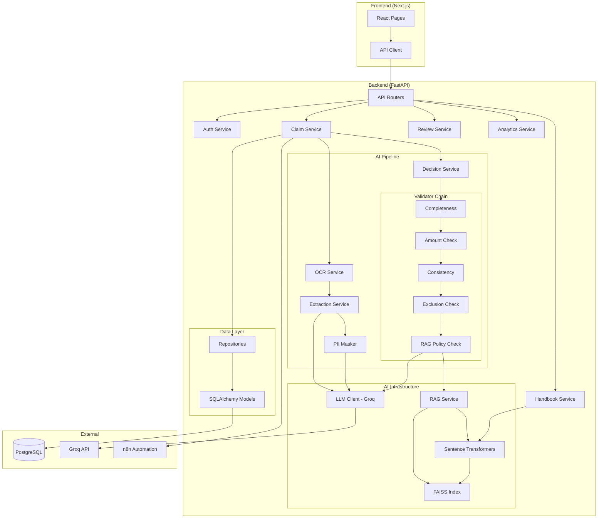
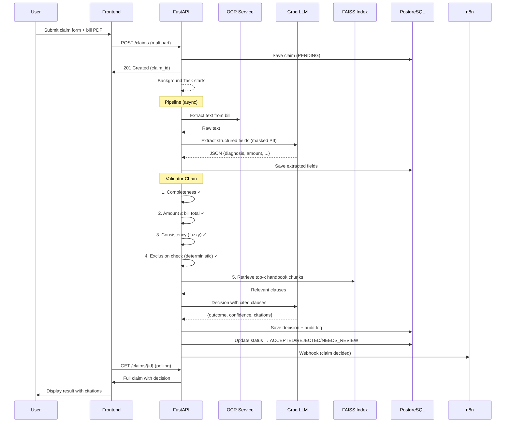

# ClaimTracker Architecture

## Component Diagram

## Data Flow (Claim Submission)

## Design Decisions

| Decision | Why |
|---|---|
| **Chain of Responsibility** for validators | Ordering matters: deterministic checks first, LLM last. Chain stops on first failure → no wasted API calls. |
| **Strategy pattern** for LLM client | Swap Groq ↔ OpenAI ↔ local model without touching any service code. |
| **Repository pattern** | No SQL in services. All queries are testable, mockable, and reusable. |
| **FAISS (not pgvector)** | Simpler deployment (no extension), fast in-memory search, good enough for a single handbook (~100-500 chunks). |
| **Exclusion check before LLM** | LLM hallucinated approvals for excluded conditions. Deterministic rule engine prevents this. |
| **Background task (not Celery)** | FastAPI BackgroundTasks are sufficient for single-server deployment. Celery/SQS would be the next step for scaling. |
| **PII masking** | PHI must not leave the network. Regex masking is the minimum; NER would be the next layer. |
| **Confidence threshold** | Prevents over-reliance on LLM. Low-confidence → human review, always. |
| **Versioned prompts** | File-based, not inline. Changes are tracked in Git. Audit log records which version was used. |
| **SQLite for dev** | Same SQLAlchemy models, zero Docker setup for quick iteration. PostgreSQL for prod. |
