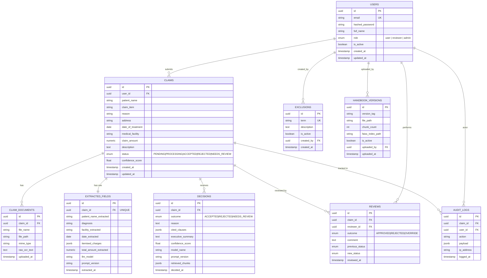

# ClaimTracker ER Diagram

## Index Strategy

| Index | Table | Column(s) | Purpose |
|---|---|---|---|
| `ix_claims_status` | claims | status | Reviewer queue filter |
| `ix_claims_created_at` | claims | created_at | Time-sorted list |
| `ix_claims_user_id` | claims | user_id | User's own claims |
| `ix_claims_confidence_score` | claims | confidence_score | Low-confidence queue |
| `ix_exclusions_term` | exclusions | term (UNIQUE) | Fast fuzzy lookup |
| `ix_users_email` | users | email (UNIQUE) | Login lookup |

## Key Design Decisions

- **UUID PKs** — no integer enumeration attacks; safe to expose in REST URLs
- **JSONB** for `itemised_charges`, `cited_clauses`, `retrieved_chunks`, `payload` — variable structure without extra tables
- **Separate `extracted_fields`** (1:1 with claim) — clean audit: form input vs OCR/LLM output
- **`handbook_versions.is_active`** — only one handbook active; rollback is a single UPDATE
- **`audit_logs.payload` JSONB** — stores full LLM decision context per call for explainability
- **`reviews` previous/new status** — human override history without losing the AI decision
